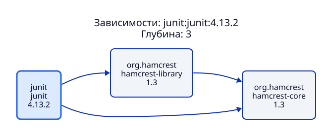
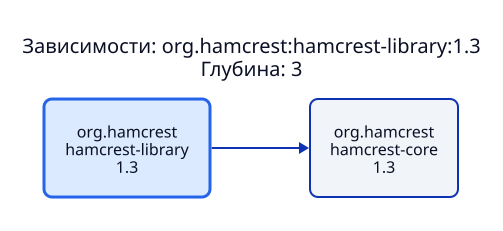
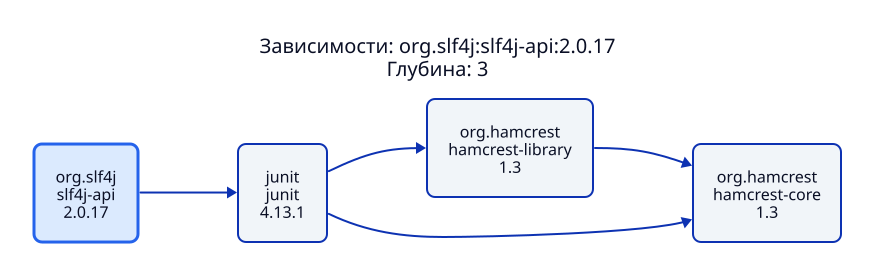

# Примеры этапа 5 и сравнение с Maven

Три пакета визуализированы приложением при `--max-depth 3`.
Каждый корневой пакет включает свою указанную версию; вершины и рёбра
считаются по уникальным Maven-координатам `groupId:artifactId:version`.
Корневая вершина входит в число вершин.

| Пакет | Наш SVG | Нативный DOT → SVG | Наш граф | Maven |
| --- | --- | --- | --- | --- |
| `junit:junit:4.13.2` | [SVG](junit.svg) | [SVG](junit.maven.svg) | 3 вершины, 3 ребра | 3 вершины, 3 ребра |
| `org.hamcrest:hamcrest-library:1.3` | [SVG](hamcrest-library.svg) | [SVG](hamcrest-library.maven.svg) | 2/1 | 2/1 |
| `org.slf4j:slf4j-api:2.0.17` | [SVG](slf4j-api.svg) | [SVG](slf4j-api.maven.svg) | 4/4 | 3/2 |

## Диаграммы приложения

### JUnit



[D2](junit.d2), [список смежности](junit.graph.txt),
[нативное дерево](junit.maven-tree.txt), [DOT](junit.maven.dot),
[JSON](junit.maven.json).

### Hamcrest Library



[D2](hamcrest-library.d2), [список смежности](hamcrest-library.graph.txt),
[нативное дерево](hamcrest-library.maven-tree.txt),
[DOT](hamcrest-library.maven.dot), [JSON](hamcrest-library.maven.json).

### SLF4J API



[D2](slf4j-api.d2), [список смежности](slf4j-api.graph.txt),
[нативное дерево](slf4j-api.maven-tree.txt), [DOT](slf4j-api.maven.dot),
[JSON](slf4j-api.maven.json).

## Методика сравнения

Использованы D2 `v0.9.0`, Apache Maven `3.9.11` и Maven Dependency Plugin
`3.8.1`. Точная версия Graphviz и параметры записаны в
[comparison.json](comparison.json). Изображения `.maven.svg` построены
Graphviz из оригинального DOT, экспортированного Maven.

Для каждого пакета скачан его опубликованный POM без изменений. Maven
запущен на нём как на корневом проекте; синтетический проект-потребитель
не использовался. Все репозитории Maven направлены зеркалом на
`https://repo.maven.apache.org/maven2`, откуда читает POM и наше приложение.
Lifecycle сборки и тесты исходного Java-проекта не запускались.

Нативная команда для каждого формата:

```sh
mvn -B -ntp -s settings.xml -f pom.xml \
  org.apache.maven.plugins:maven-dependency-plugin:3.8.1:tree \
  -Dverbose=true -DoutputType=text -DoutputFile=maven-tree.txt
```

Аналогично получены `dot` и `json` заменой `-DoutputType` и имени файла.
Фильтр `scope` не задавался. Исходные текст, DOT и JSON сохранены рядом
с диаграммами; у DOT удалены только завершающие пробелы строк.
URL и SHA-256 исходных POM находятся в отчёте.

JSON-дерево объединяется по GAV, затем применяется тот же BFS с глубиной 3.
Повторные вхождения не увеличивают число вершин, но сохраняют входящие
рёбра. Сравнение нормализует тип, classifier и scope до используемой
приложением идентичности GAV. В этих примерах нет выбора конфликтующих
версий. В общем случае JSON следует читать вместе с текстовыми пометками
Maven о пропущенных дубликатах и конфликтах.

## Объяснение результатов

**JUnit:** графы совпадают. В нативном дереве ребро от `hamcrest-library`
к `hamcrest-core` помечено `omitted for duplicate`. Это повторное
вхождение уже существующего пакета, а не новая вершина. В DOT Maven
показывает его отдельным подписанным узлом дерева; при объединении по GAV
получаются те же 3 вершины и 3 ребра.

**Hamcrest Library:** совпадают 2 вершины и одно ребро к `hamcrest-core`.

**SLF4J API:** опубликованный родительский POM задаёт тестовую зависимость
`junit:junit:4.13.1`. Наш алгоритм читает все объявления зависимостей на
каждом уровне, поэтому также включает тестовую зависимость самого JUnit:
`org.hamcrest:hamcrest-library:1.3`, а затем её ребро к `hamcrest-core`.

Maven не распространяет тестовые зависимости транзитивно, поэтому в его
результате остаётся цепочка `slf4j-api → junit → hamcrest-core`:
3 вершины и 2 ребра. У приложения — 4 вершины и 4 ребра. Это известное
ограничение статической модели POM из этапов 2–3, а не потеря рёбер при
генерации D2 или рендеринге SVG. Глубина 3 не является причиной разницы.

Нативные деревья показывают scopes, приложение отображает GAV. Реализация
также не моделирует исключения, активацию профилей, optional-транзитивность
и разрешение конфликтов версий. Совпадение первых двух примеров не
означает полной эквивалентности Maven Resolver.

Описание нативных форматов:
[Maven Dependency Plugin](https://maven.apache.org/plugins/maven-dependency-plugin/examples/tree-mojo.html).
Правила транзитивности:
[Maven dependency mechanism](https://maven.apache.org/guides/introduction/introduction-to-dependency-mechanism.html).

## Воспроизведение

Из корня репозитория, с установленными D2 и Maven:

```sh
python3 -m scripts.reproduce_examples --maven /path/to/maven/bin/mvn
```

Нужен доступ к Maven Central. Для одинакового эталона используйте Maven
`3.9.11`; версия плагина закреплена в скрипте. Если установлен `dot`,
дополнительно генерируются `.maven.svg`. Для другого каталога добавьте
`--output /path/to/examples`.

Само приложение не вызывает Maven. Только этот отдельный скрипт
использует его для требуемого сравнения. POM, временные логи, JAR и кеши
инструментов не сохраняются в репозиторий.
